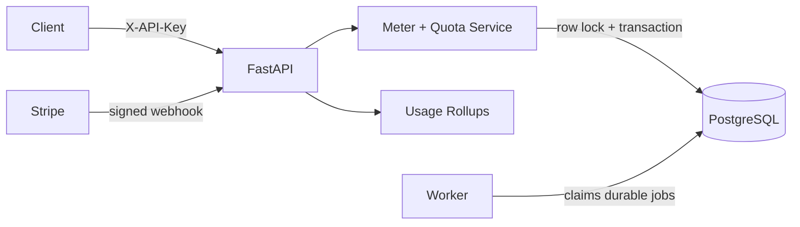

# Usage Metering & Billing Engine

A PostgreSQL-backed FastAPI billing engine for tenant usage metering, monthly quotas, exact micro-USD cost calculation, idempotent generation requests, and Stripe test-mode subscriptions.

## Plans

| Plan | API calls/month | AI tokens/month | Metered cost | Subscription fee |
|---|---:|---:|---|---:|
| Free | 1,000 | 100,000 | Pay-by-usage | $0/month |
| Pro | 10,000 | 1,000,000 | Same rates | $19/month |

Calendar-month metering periods are independent of Stripe subscription billing periods.

## Pricing

- API call: 1 micro-USD = $0.001
- Fresh input: 1 micro-USD/token
- Cached input: 0.25 micro-USD/token
- Output: 4 micro-USD/token
- Reasoning: 4 micro-USD/token

Totals use integer micro-USD. Each cached-token fraction is rounded half-up to a micro-USD at category cost boundaries, so 1 cached token costs 0 micro-USD, 2 cost 1 micro-USD, and 3 cost 1 micro-USD. Historical costs are immutable in usage events.

## Architecture



Tenant isolation is enforced from the API key; clients never provide tenant IDs. Metering locks the tenant row and uses an `(tenant_id, idempotency_key)` database uniqueness constraint. The request fingerprint prevents key reuse with a different payload. Rejected quota/payment responses are deterministically persisted under the key; after changing conditions, clients must use a new key.

## Docker startup

Copy `.env.example` to `.env`, then:

```powershell
docker compose up --build -d
docker compose exec api python -m scripts.seed
```

Run the worker separately:

```powershell
docker compose up -d worker
```

Native Python:

```powershell
python -m venv .venv
.\\.venv\\Scripts\\Activate.ps1
pip install -e ".[test]"
alembic upgrade head
python -m scripts.seed
uvicorn app.main:app --host 0.0.0.0 --port 8000
```

## Demo credentials

Demo API keys are configurable in `.env`; defaults are `demo_tenant_a_key` and `demo_tenant_b_key`. Production-style keys must be high-entropy. Only SHA-256 hashes are stored.

## API

- `GET /health`
- `GET /usage`
- `POST /generate` with `X-API-Key` and `Idempotency-Key`
- `POST /billing/checkout`
- `POST /webhooks/stripe`
- Swagger: `http://localhost:8000/docs`

Example:

```powershell
$headers = @{ "X-API-Key" = "demo_tenant_a_key"; "Idempotency-Key" = "request-001" }
Invoke-RestMethod -Uri http://localhost:8000/generate -Method Post -Headers $headers -ContentType "application/json" -Body '{"input_tokens":1000,"cached_input_tokens":500,"output_tokens":200,"reasoning_tokens":100}'
```

Fresh input excludes cached input. Output excludes reasoning output. These categories are disjoint and therefore not double-counted.

## Quotas and Stripe

`429` means the monthly usage quota is exhausted; `Retry-After` is the UTC reset time in seconds. `402` means subscription/payment state blocks the action. Rejected requests do not create usage events.

Configure Stripe test-mode keys and a recurring USD 19 Pro price. Live keys and live-mode webhook events are rejected. Never place secrets in source control.

With Stripe CLI:

```powershell
stripe login
stripe listen --forward-to localhost:8000/webhooks/stripe
stripe trigger checkout.session.completed
```

Browser Checkout must never upgrade a tenant directly. Verified Stripe webhooks are the authority. Use test card `4242 4242 4242 4242`, a future expiry, and any valid CVC.

### Secure Stripe test-mode setup

1. Create a free Stripe account and open the Dashboard in Test mode.
2. Confirm the Dashboard URL indicates test mode. Never enter or commit live-mode keys.
3. Create a recurring product with a USD 19 monthly price.
4. Copy the test Secret key from Developers → API keys.
5. In `.env`, set:

```dotenv
STRIPE_SECRET_KEY=sk_test_<your_local_test_key>
STRIPE_PRO_PRICE_ID=price_<your_test_price_id>
```

Do not paste keys into source files, screenshots, chat, or documentation.

6. Run the Stripe CLI login with the installed Windows executable:

After installing with winget, restart PowerShell and run:

```powershell
stripe login
```

If `stripe` is not found, locate the winget executable:

```powershell
Get-ChildItem "$env:LOCALAPPDATA\Microsoft\WinGet\Packages" -Filter stripe.exe -Recurse
```

7. Forward signed webhooks:

```powershell
stripe listen --forward-to localhost:8000/webhooks/stripe
```

Copy the CLI's displayed `whsec_...` signing secret into `STRIPE_WEBHOOK_SECRET` in `.env`, then restart Docker Compose.

8. Create Checkout for Tenant A:

```powershell
$headers = @{ "X-API-Key" = "demo_tenant_a_key" }
$session = Invoke-RestMethod -Uri http://localhost:8000/billing/checkout -Method Post -Headers $headers
Start-Process $session.checkout_url
```

Complete Checkout with `4242 4242 4242 4242`, a future expiry, and any valid CVC. Upgrade evidence must come from `GET /usage`, not from the browser success page:

```powershell
Invoke-RestMethod -Uri http://localhost:8000/usage -Headers $headers
```

The tenant is upgraded only after a verified `checkout.session.completed` or synchronized subscription event. Replay handling can be tested by replaying the same Stripe event in the CLI; the database event ID must remain unique.

Subscription behavior: `active` and `trialing` are serviceable and use Pro limits. `past_due` and `unpaid` require payment and return `402`. Confirmed deletion or cancellation falls back to Free. An older update will not be used to restore a tenant after a confirmed deletion in the durable state model.

## Tests

```powershell
pytest
ruff check .
alembic upgrade head
```

PostgreSQL is required for transaction, locking, and concurrency tests. CI provides it through a GitHub Actions service.

## Limitations

API-key authentication is deliberately lightweight for this capstone. The Stripe integration is test-mode only. The background worker is PostgreSQL-backed, uses bounded retries, and emits structured exhaustion alerts.
