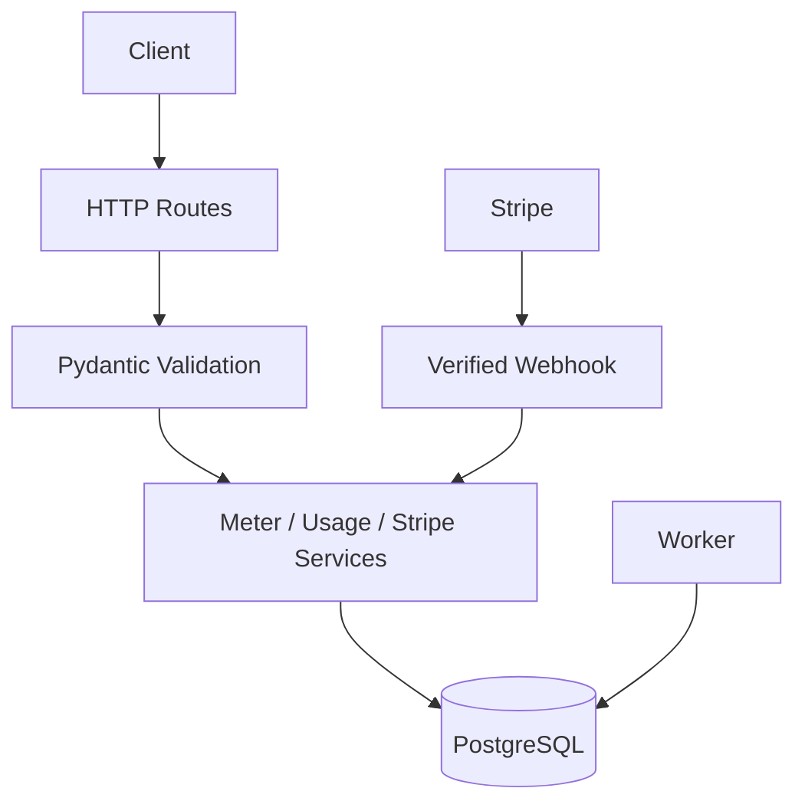

# Usage Metering & Billing Engine Design

## Problem and goals
Customers need accurate usage totals, monthly API/token quota enforcement, exact costs, and a test-mode Stripe subscription lifecycle. The service will be small, transactional, and tenant-isolated.

## Functional requirements
Meter one logical action once with an idempotency key; enforce Free/Pro UTC calendar-month limits; calculate integer micro-USD costs; synchronize Stripe state through verified webhooks; provide health and usage APIs; and reconcile usage through a durable worker.

## Database
Tenants -> effective Subscriptions -> Plans. Tenants -> UsageEvents; Tenants -> IdempotencyRecords. Separate ProcessedStripeEvents and BackgroundJobs tables preserve payment deduplication and durable retries.

## API
`GET /health`, `GET /usage`, `POST /generate`, `POST /billing/checkout`, and `POST /webhooks/stripe`, plus Swagger.

## Architecture
HTTP routes use Pydantic schemas and authenticated dependencies, services contain metering/quota/payment logic, SQLAlchemy repositories/database sessions provide persistence, and the worker claims PostgreSQL jobs separately.

Each HTTP API key maps to one tenant. Tenant rows are locked before quota checks and usage insertion. `tenant_id + idempotency_key` is unique; request fingerprints distinguish payload reuse. Cost uses pinned integer micro-USD rates and immutable event pricing versions.

## Stripe and jobs
Checkout is server-configured and tenant-associated. Webhooks verify signatures, deduplicate event IDs, commit state and processing atomically, and use documented Free fallback on confirmed deletion/cancellation. A PostgreSQL worker schedules, claims, retries, and alerts on reconciliation failures.

## Non-goals
Real payments, real AI calls, production identity management, complex invoicing, proration, and overage billing.
